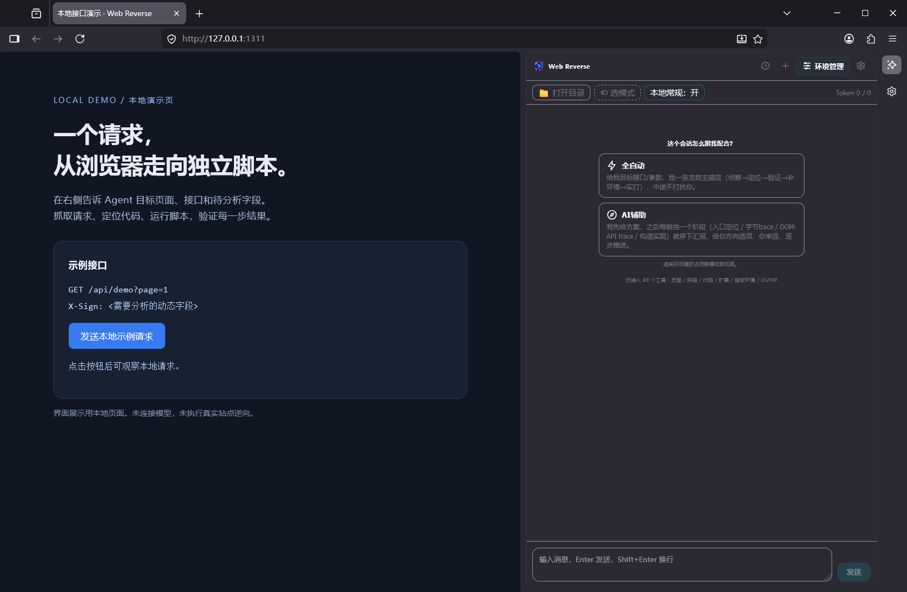

<div align="center">


# Web Reverse

### 把网页里的签名算法，带回你的 Node.js / Python 脚本。

内置 AI Agent 的 Firefox 浏览器，面向 JS 逆向、JSVMP / WASM 分析与网页自动化。

**给出页面和目标接口，让 Agent 抓请求、查代码、追踪执行、编写脚本，再运行验证。**

[**下载 Windows EXE**](https://github.com/zhang-pre/browser-agent/releases/download/v0.24.1-web-reverse/web-reverse-v0.24.1-windows-x86_64.exe) · [快速开始](#快速开始) · [功能亮点](#功能亮点) · [全部下载](https://github.com/zhang-pre/browser-agent/releases/tag/v0.24.1-web-reverse) · [文档](#文档导航)

Windows 10/11 x64 · v0.24.1 体验版 · 已内置 Node.js / npm / Python / pip

</div>



<p align="center"><sub>Windows 实际界面；截图使用本地演示页，尚未连接模型。</sub></p>

## 它能帮你做什么？

一个接口在浏览器里能正常请求，换成自己的脚本却失败：`sign` 每次都变，`token` 不知道从哪来，算法还藏在混淆代码、JSVMP 或 WASM 里。

Web Reverse 把分析现场和 AI 放在同一个浏览器中。你提供目标，Agent 可以读取网络请求、搜索脚本、观测执行过程，在本地写代码并运行对照。**目标是交付能够重复执行的脚本和分析证据。**

| 你想做的事 | 可以交给 Agent 的任务 |
| --- | --- |
| 找到动态参数的生成位置 | 从接口地址、请求头或参数名入手，关联请求与脚本，追踪关键函数和运行时值 |
| 将浏览器请求迁移到脚本 | 分析必要的浏览器依赖，在工作目录生成 Node.js / Python 代码，运行并验证 |
| 看懂受保护的算法 | 使用 JSVMP 指令记录、WebAPI 观测、WASM 分析和分支对照，逐步缩小范围 |
| 分开管理多个分析现场 | 创建独立浏览器环境，分别保存 Cookie、站点存储与指纹配置 |

## 快速开始

### 1. 下载安装

**[下载 Windows x64 安装包（EXE，约 121 MB）](https://github.com/zhang-pre/browser-agent/releases/download/v0.24.1-web-reverse/web-reverse-v0.24.1-windows-x86_64.exe)** → 运行安装向导 → 从开始菜单打开 **Web Reverse**。

无需编译源码，也无需额外安装 Node.js、Python 或 VC 运行库。

| 下载 | 使用方式 |
| --- | --- |
| [Windows 安装版 `.exe`](https://github.com/zhang-pre/browser-agent/releases/download/v0.24.1-web-reverse/web-reverse-v0.24.1-windows-x86_64.exe) | 运行安装向导，安装后打开 Web Reverse |
| [Windows 便携版 `.zip`](https://github.com/zhang-pre/browser-agent/releases/download/v0.24.1-web-reverse/web-reverse-v0.24.1-windows-x86_64.zip) | 完整解压，运行 `firefox/firefox.exe`，保留整个目录 |
| [发布说明与 SHA256 校验](https://github.com/zhang-pre/browser-agent/releases/tag/v0.24.1-web-reverse) | 查看版本说明、验证记录与文件校验值 |
| macOS / Linux | 当前下载入口提供 Windows 包；其他平台见[源码构建](#源码构建)与[分发文档](docs/distribution.md) |

这是尚未数字签名的体验版。若出现 Windows 发布者提示，可先核对 Release 中的校验值。旧版用户升级时请沿用原安装目录，继续读取已有配置与会话。

### 2. 打开侧栏，配置模型

点击浏览器侧栏中的 **Web Reverse 星光图标**，再点面板右上角的 **设置**。

新建模型配置，选择服务商，填写 **API Key、模型**，然后点击 **保存并使用**。支持 DeepSeek、GLM、Kimi、MiniMax、Qwen，以及兼容 OpenAI / Anthropic 协议的自定义端点；同一服务商可以保存多套配置。

模型账号需要自行准备，调用费用由所选服务商收取。订阅登录方式见[模型接入说明](docs/pi-provider-chatgpt-subscription.md)。

### 3. 选一个工作目录和模式

点击 **打开目录**，为当前会话选一个本地文件夹。生成的脚本、采集结果和分析文件会写入这里，方便查看与继续修改。

首次体验可以选择 **AI 辅助**，逐阶段查看结果；目标明确时选择 **全自动**，让 Agent 连续调用工具推进。保留默认开启的 **本地常规**，即可使用浏览器内置的页面和网络工具。

### 4. 发出第一个任务

打开你要分析的页面，把下面的内容换成自己的目标后发送：

```text
页面：https://example.com/list
接口：GET https://example.com/api/list?page=1
需要分析的字段：请求头 X-Sign

请先记录并定位这个请求，找到 X-Sign 的生成入口，说明它依赖哪些输入。
然后在当前工作目录生成 Node.js 实现，运行并与浏览器结果对照。
如果还需要原始混淆代码或 WASM，请说明依赖；验证通过后再继续提取独立算法。
```

也可以先发一个较小的任务熟悉工具：**“查看当前页面的标题和按钮，记录我下一次点击产生的请求，列出 URL、方法和状态码。”**

需要登录态时，先在目标页面完成登录。任务结果取决于目标保护方式、可获得的运行证据和所选模型；请以脚本实跑与接口返回结果验收。

## 功能亮点

- **分析、写代码、运行验证在同一个工作流里。** Agent 能连续调用页面、网络、源码和文件工具，并通过 Node.js / Python 检验自己的实现。
- **深入浏览器执行过程。** SpiderMonkey 解释器与 Gecko WebIDL 边界接入原生观测点，用于 JSVMP 指令和 WebAPI 依赖分析；另有签名、闭包与 WASM 分析工具。
- **收起侧栏后继续执行。** Agent Runtime 在浏览器父进程运行，切换标签页或关闭侧栏后，可以重新打开查看进度。
- **每个环境保存自己的现场。** 独立 profile、进程和控制端口，支持环境创建、导入、编辑、启动、关闭，以及指纹配置管理。
- **模型与工具可以扩展。** 支持命名模型配置、本机或工作区的 `SKILL.md`、第三方 MCP，以及 Firefox 扩展管理。
- **产物可带走，经验可积累。** 会话支持导入 / 导出，文件保存在本地工作目录，SQLite 记忆可保存和检索已验证的事实、失败路径与结论。

原生观测、调试通道与页面注入各有适用范围。JSVMP 追踪会影响 JIT 和时序；网络工具读取请求元信息与可获得的调用来源，当前不采集响应 body。详细边界见[能力与限制](docs/features.md)。

## 两种工作模式

| 模式 | 适合什么情况 | 如何配合 |
| --- | --- | --- |
| **全自动** | 目标和验收条件明确，希望连续推进 | 说明目标与交付要求；运行中可以补充约束，也可以停止 |
| **AI 辅助** | 想逐步学习、审阅分析过程或调整路线 | 查看阶段结果，再决定下一步 |

需要双模型协作时，可以用外部 director 审阅阶段结论，由浏览器内的 worker 执行工具操作。配套项目：[browser-agent-mcp](https://github.com/zhang-pre/browser-agent-mcp)；详细用法见[进阶协作](docs/advanced-usage.md)。

## 内置工具

覆盖页面交互、网络请求、脚本检索、签名与闭包、WebAPI、JSVMP、WASM、文件执行、环境管理和本地记忆。工具参数由 Agent 按任务选择；需要手动调用或接入 MCP 时，查看[完整工具清单](docs/tools.md)。

## 常见问题

**找不到 Web Reverse 面板？** 先通过地址栏附近的侧栏按钮展开侧栏，再选择 Web Reverse 星光入口。

**模型不响应，或提示缺少 Key？** 在设置中确认当前选中的模型配置，填写账号与模型后点击“保存并使用”。自定义服务还需核对端点和协议。

**生成的代码在哪里？** 在当前会话顶部“打开目录”所绑定的文件夹中；新会话需要选择自己的工作目录。

**升级会丢数据吗？** 显示名称已改为 Web Reverse，原配置标识和数据路径保留。升级前备份完整 profile 和工作目录，安装时沿用旧位置；详见[升级与已有数据](docs/distribution.md#改名与已有数据)。

## 文档导航

| 想了解什么 | 文档 |
| --- | --- |
| 侧栏、会话与模型设置 | [侧栏使用](docs/agent-sidebar.md) · [订阅接入](docs/pi-provider-chatgpt-subscription.md) |
| 功能覆盖与工具参数 | [能力与限制](docs/features.md) · [完整工具清单](docs/tools.md) |
| 指纹与独立浏览器环境 | [环境管理](docs/fingerprint-environment-manager.md) · [原生一致指纹](docs/native-fingerprint-consistency.md) |
| 分阶段逆向与双模型协作 | [进阶用法](docs/advanced-usage.md) · [逆向 SOP](docs/agent-reverse-sop.md) |
| 第三方工具接入 | [MCP 客户端](docs/mcp-client.md) |
| 架构、开发与测试 | [架构](docs/architecture.md) · [开发指南](docs/development.md) · [测试](tests/README.md) |

## 源码构建

直接使用 Windows 版请下载上面的 EXE。需要修改内核、开发侧栏或构建其他平台时，参阅[源码构建与开发](docs/development.md)、[打包与发布](docs/distribution.md)及[上游同步](docs/upstream-sync.md)。

仓库保存定制 Firefox 的增量源码与接入脚本，主要实现位于 `additions/`。开发 profile 位于对象目录内，清理或从零构建前请先完整备份。
